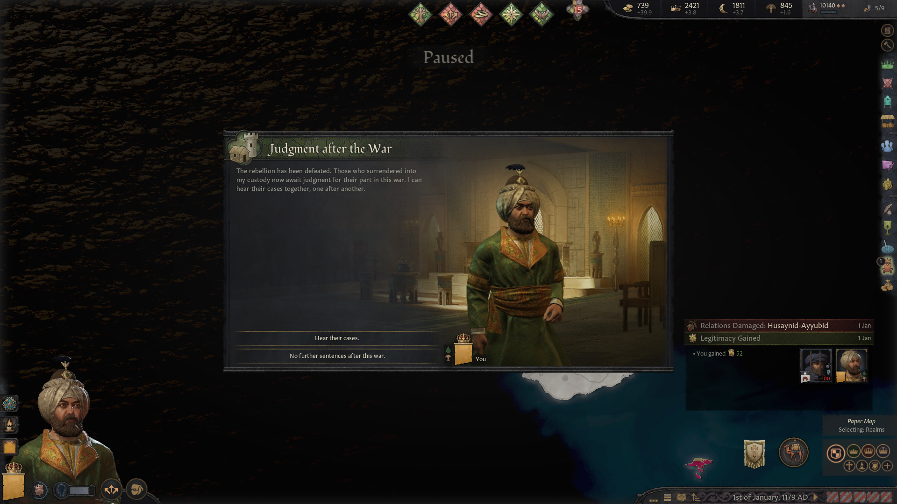
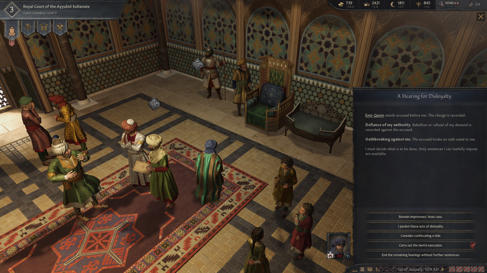

# Traitor Trials

**Dedicated to everyone who misses AGOT while waiting for its next update.**

## At a glance

- 🟢 **Version 0.1.0** · Targets CK3 **1.21.0.3**.
- 🟢 **Built-in compatibility with More Interactive Vassals (MIV) 5.7**, including **Oathbreaker**. **No separate compatibility patch required.** MIV is optional. Traitor Trials works standalone.
- 🟢 Deal with defeated rebels in one automatically opened, paused hearing chain.
- 🟢 Royal Court presentation when available, with ordinary events for other rulers. No required DLC.
- 🟢 **Languages:** English, French, German, Japanese, Korean, Polish, Russian, Simplified Chinese and Spanish.
- 🔴 Eligible defeated subjects enter custody as part of surrender. Title selection retains CK3's costs, restrictions and tyranny rules.
- 🔴 Single-player scope. Mods replacing the Revoke Title window need compatibility work.

## The war is won. Hear the verdicts.

Your rebels have surrendered. Bring them before you one at a time, decide their fate, and move straight to the next case. Handle the settlement through a single sequence of verdicts.

## One court, individual sentences

When you win a war as its primary attacker or defender, the mod gathers eligible subjects from the losing side who rebelled against you or broke their oath to you. Those still free enter your custody as part of surrender. Foreign allies, unrelated prisoners and people imprisoned by another ruler are excluded. White peace does not open a trial.

- **Keep imprisoned:** leave the sentence unchanged and hear the next case.
- **Pardon:** forgive the political charges. Unrelated crimes remain. Release follows only if no other criminal grounds remain.
- **Execute:** available only with a current legal execution reason and the applicable restrictions satisfied.
- **Confiscate titles:** open CK3's normal Revoke Title window for an eligible imprisoned direct vassal. Choose titles with the usual rules and consequences. Sending or cancelling advances to the next case. The prisoner's acceptance is guaranteed.

The game stays paused throughout the hearings and title selection. You resume time when finished. You can also finish the remaining cases without adding a sentence or granting a pardon.

## Getting started

1. Enable Traitor Trials in your playset.
2. As a landed ruler, win a war as the primary attacker or defender. The trial invitation appears automatically when eligible rebels have surrendered.
3. Open the hearings and choose a verdict for each accused, or skip the whole settlement without an additional sentence.

## Compatibility and load order

Traitor Trials is a standalone mod for vanilla CK3. When using the optional More Interactive Vassals 5.7, load Traitor Trials after it.

With Royal Court and a royal court of your own, hearings take place there. Other rulers use ordinary character events.

The mod replaces `gui/interaction_revoke_title.gui` to continue the hearings when the native title picker closes. Another mod replacing that window needs a patch combining both changes. Total conversions and multiplayer are outside this release's supported scope.

## Saves and known limits

Only newly resolved wars can supply a trial. Already completed wars cannot be reconstructed. Cases stay tied to their recorded defeated side. A trial does not create fresh punishment rights or restore rights already spent.

Keep a backup before adding or removing the mod. Finish the hearing chain and close the title picker before saving or disabling it. Reloading in the middle of either is not a supported workflow. Custody, pardons, deaths and title transfers already applied remain after removal.

## Feedback and support

Include your game and mod versions, playset order, the war outcome and what happened during the hearing or title selection.

[Report an issue on GitHub](https://github.com/G4VV4KH/-CK3-Traitor-Trials/issues)

Email: g4vv4kh@gmail.com

### [Want to support my work? Donate on Ko-fi 💛](https://ko-fi.com/g4vv4kh)

## Find this mod elsewhere

- [GitHub](https://github.com/G4VV4KH/-CK3-Traitor-Trials)

## My other mods

### Standalone mods

- [Parley: The Negotiating Table](https://steamcommunity.com/sharedfiles/filedetails/?id=3811090081) — negotiate diplomatic agreements.
- [Marriage Calculation Assistant](https://steamcommunity.com/sharedfiles/filedetails/?id=3811100163) — compare and sort marriage candidates.
- [Your Own Hegemony](https://steamcommunity.com/sharedfiles/filedetails/?id=3811201582) — found a custom hegemony.
- [Vassalization Extended](https://steamcommunity.com/sharedfiles/filedetails/?id=3813943691) — choose Forced Vassalization terms without a county limit.
- [Court Automation](https://steamcommunity.com/sharedfiles/filedetails/?id=3814028714) — automate court positions and recruit courtiers or knights.
- [Nomad Autorefill](https://steamcommunity.com/sharedfiles/filedetails/?id=3814793283) — automatically reinforce nomadic Men-at-Arms using herd or gold.
- [Tax Collection Automation](https://steamcommunity.com/sharedfiles/filedetails/?id=3815381275) — automatically assign tax collectors and optimize tax jurisdictions.
- [Council Assignment Automation](https://steamcommunity.com/sharedfiles/filedetails/?id=3815689627) — automate council appointments and optimize councillor assignments.
- [Strategist Assistant](https://steamcommunity.com/sharedfiles/filedetails/?id=3827659479) — plan armies, recruitment and wars.
- [Title Domination](https://steamcommunity.com/sharedfiles/filedetails/?id=3828276945) — proclaim uncreated titles through diplomacy and war.
- [Accolade Workshop](https://steamcommunity.com/sharedfiles/filedetails/?id=3836819350) — choose accolade attributes or knights first and set rank limits.

### Compatibility patches

- [[compatch] CAA + CA](https://steamcommunity.com/sharedfiles/filedetails/?id=3816373375) — use Council Assignment Automation and Council Autopilot together.

## Credits

Cover artwork was generated with AI.

## Screenshots

The trial begins with the war settlement.

Choose a verdict, then continue to the next accused.

## Contributing

See [developer notes](dev.md) for implementation and contribution guidance.
